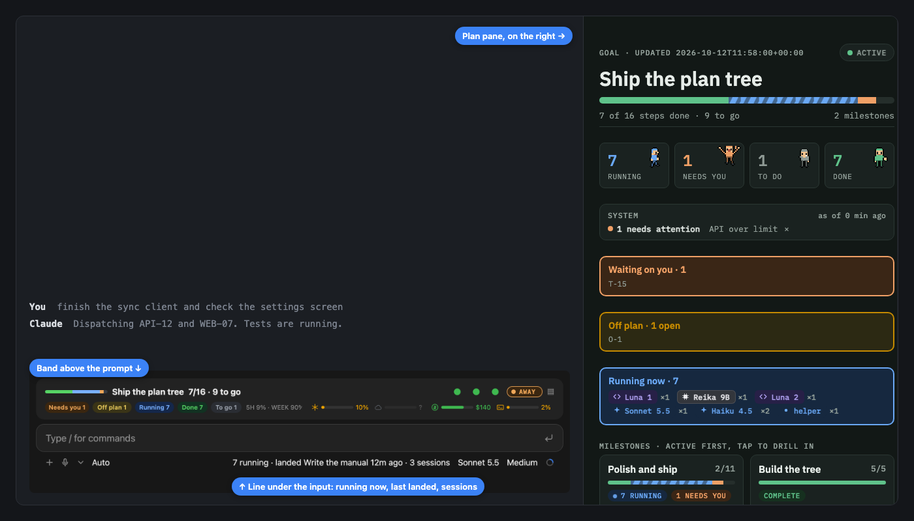
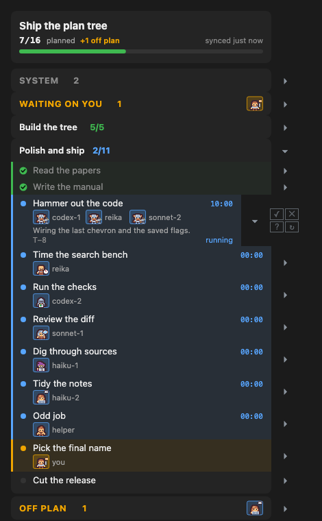
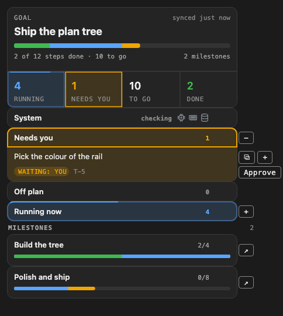

# Claude Cockpit

A live plan, status row and agent view for Claude Code. It shows what your sessions and agents are doing, how far along the plan is, and how much plan and credit you have left.

<p align="center">
  <picture>
    <source media="(prefers-color-scheme: light)" srcset="docs/img/where-light.png">
    
  </picture>
</p>

## The panel

The plan as a calm tree. Open a section to see its steps, who is working on each, and what is waiting on you.

<p align="center">
  <picture>
    <source media="(prefers-color-scheme: light)" srcset="docs/img/shot-milestone-light.png">
    
  </picture>
</p>

<p align="center">
  <picture>
    <source media="(prefers-color-scheme: light)" srcset="docs/img/shot-waiting-light.png">
    
  </picture>
</p>

## Why you want it

- **See every agent at a glance.** One pane shows who is editing, who is running tests, who is blocked and who is waiting on you.
- **Know how far along you are.** A progress bar and a count like `7/16 · 9 to go` sit right above your input box. The plan is a calm tree of milestones and steps.
- **Never get surprised by your limits.** Meters show what is left on your Claude plan, Claude cloud, API spend and Codex.
- **Leave it running.** Flip AWAY before you go. Your main session keeps working without stopping to ask, and writes down its choices for you.
- **Keep it private.** Nothing leaves your machine.

The plan page also lets you ask a question on any step, copy a step ID, open items in place and dismiss system issues. See [every feature](docs/FEATURES.md) for pictures of each.

## Install

You need Claude Code. Add tmux if you want to watch Codex or local-model sessions too.

1. Add the marketplace:

   ```
   claude plugin marketplace add JesseWebDotCom/claude-cockpit
   ```

2. Install the plugin:

   ```
   claude plugin install cockpit@claude-cockpit
   ```

   It may print "7 userConfig options not yet set". That is fine: every option is optional.

3. Restart Claude Code and type `/cockpit`. The pane opens. Type it again to close it.

Then add the short block from [docs/RULES-FOR-CLAUDE.md](docs/RULES-FOR-CLAUDE.md) to your project's `CLAUDE.md` (about 210 tokens a session). The band and pane cost the model nothing.

Want to try it first? Clone the repo and run `claude --plugin-dir ./claude-cockpit`. To see a full pane right away, look at `examples/project`.

## Make it yours

Cockpit works with no setup. To change something, add `.cockpit/config.json` to your project; every key is optional. Run `/cockpit-status` to see what was read. Every setting is in [docs/CONFIG.md](docs/CONFIG.md).

## Learn more

- [Every feature and every part of the pane](docs/FEATURES.md)
- [Rules for Claude, and what they cost in tokens](docs/RULES-FOR-CLAUDE.md)
- [The plain files your agents write](docs/PROTOCOL.md)
- [Changelog](docs/CHANGELOG.md)

## Credits and license

MIT, see [LICENSE](LICENSE). It builds on [claude-flightdeck](https://github.com/scasella/claude-flightdeck) and [savvy-progress](https://github.com/JohnnyVizz/claude-kit/tree/main/plugins/savvy-progress); notices are in [NOTICE](NOTICE).
