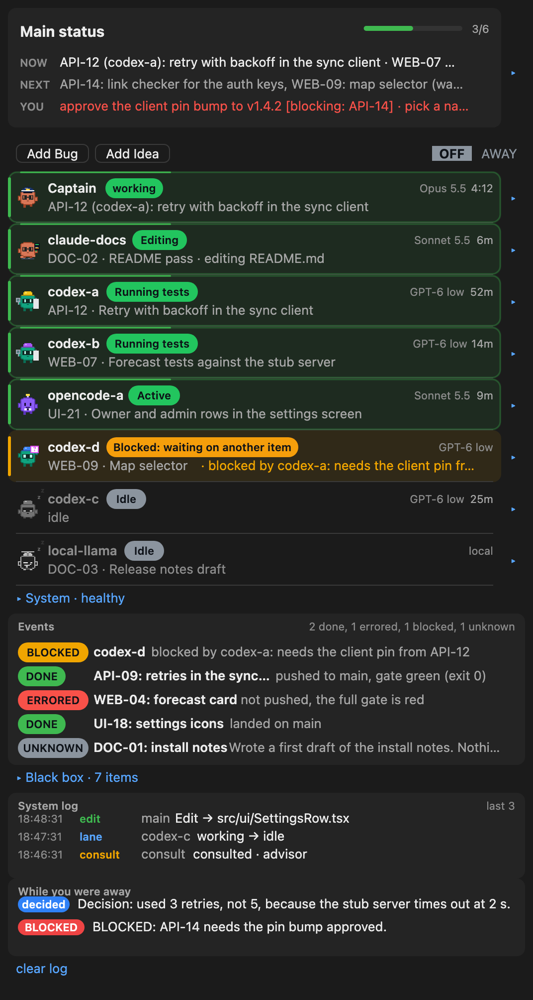
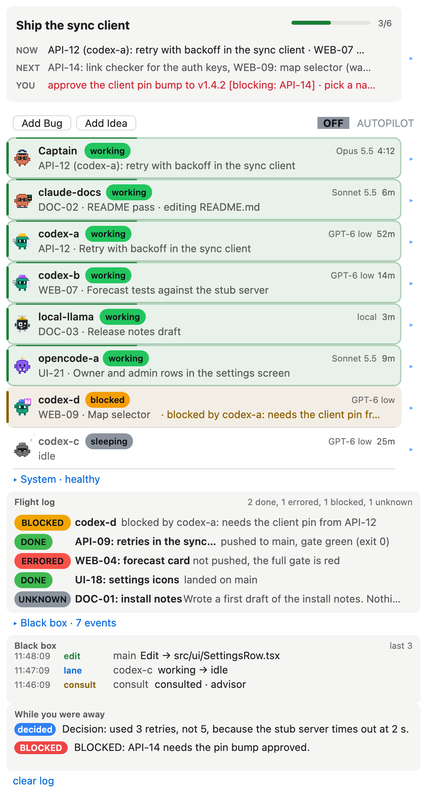
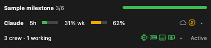
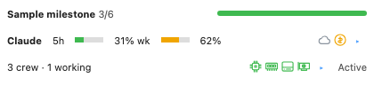

# Claude Cockpit

Claude Cockpit is a Claude Code plugin built around one idea: a captain. The captain is the Claude Code session you talk to. It plans
the work, hands pieces to other sessions, checks what they report back, and keeps the whole job moving. Cockpit is the captain's
pane: one view beside that session of every session under its command.

The crew has two kinds of members:

- **Claude sessions:** other Claude Code sessions on your Claude Max plan, Claude cloud sessions, and sessions billed through the API.
- **Other agents:** Codex, local coding models and OpenCode, each running in its own tmux session.

Cockpit helps the captain manage all of its agents and their work. It picks the right model for each job and uses agents across
your services, which saves you time and money:

- **Cheap work goes to cheap models.** Reading and searching go to a small, fast model. Building from a clear plan goes to a
  mid-size model, or to Codex or a local model, which cost little or nothing against your Claude plan.
- **Hard work goes to the smartest model.** Architecture, refactoring and anything complex, because a wrong design costs far more than
  the model does. The same goes for a hard decision, a subtle bug or a risky change.
- **The captain thinks and checks; the crew types and runs.** The expensive model is spent where it matters, so your credits last
  longer.

Everything you need is in one place, up front: progress on each task, what is next, what is waiting on you, and how much credit is
left in each service.

There is even an Autopilot mode. Switch it on before you leave and the captain keeps coding without stopping to ask, logging its
decisions for you instead of leaving a question pending. You come back to finished work, not to coding that stopped hours ago.

It is also colorful and playfully animated: every crew member is a small animated character, so you can tell at a glance who is busy,
who is idle and who needs you.

The plugin itself does not run your agents or choose models; the captain does that. The plugin only reads tmux and a few plain files your agents write, and shows
them. The files are described in [docs/PROTOCOL.md](docs/PROTOCOL.md).

<p align="center">
  
  
</p>

The pictures are drawn from the synthetic project in `examples/project` (an invented app, a user called alex, example.com) with
`tools/shot.ts`. The buttons and the plain text around the cards are simulated in the picture; the cards are drawn by the plugin's own
code.

## What the pane shows

The pane is one scrolling page. Top to bottom:

1. **Status card.** The milestone, a progress bar and count, then NOW, NEXT and YOU in one line each. The arrow opens all three in full.
   YOU is what waits on you; it turns red when something is blocked on it.
2. **Buttons.** Add Bug and Add Idea (one line of text, saved to a file and sent to your coordinating session), and an Autopilot switch: the word AUTOPILOT in grey when off and green when on (colour is the only state; there is no "off" or "on" text).
3. **Crew.** A collapsible line ("Crew", with a summary such as "2 working, 1 idle"; open by default, and the choice is remembered) over one row per agent session, with an animated character, a status word, the item it owns, what powers it (GPT-6, Sonnet 5.5,
   local) and how long it has been in that state. The Captain (the session Cockpit runs in) is first. An active row has a moving green
   border, a blocked or waiting row is amber, a failed one is red, a sleeping one is grey. Open a row for what it is doing, its task,
   its last report and its limits. A crew member whose account refused it shows a red label on its row (OUT OF CREDIT, RATE LIMITED or AUTH FAILED) with the matching output line on its card, a red count in the Crew summary, and a red chip on the status card and the status bar; it clears when newer output no longer shows the error.
4. **System card.** Collapsed to one line ("System: healthy"). Open it for this computer's memory, CPU and disk gauges (each row starts with
   its icon in the gauge's health colour), the plan limits,
   and, if you list them under `hosts` and `services` in the config, other computers (memory, GPU) and services (up or down).
   Nothing listed means nothing else is checked. The five sections always appear in one fixed order (Main status, Crew, System, Flight log, Black box) and every header is always visible. Each section has its own open or closed flag, saved on its own and written only by that section's arrow; opening or closing one never moves, opens, closes or hides another. Main status and Crew start open, the other three closed. When the open bodies are taller than the pane, the whole pane scrolls as one column.
5. **Flight log.** What finished and what did not, newest first: DONE, ERRORED, BLOCKED or UNKNOWN, two rows each (the status and the title, then the details: what happened, who did it and when, cut to one line), judged from the
   agents' report files.
6. **Black box.** The last events of this session: your prompts, subagents, edits, errors, denied tool calls, and lanes changing between
   working and idle. Open it for the last 40.

When you press Autopilot, Cockpit tells the Captain you are away and to log its decisions. A "While you were away" card then collects
them for when you return.


## Features

- **tmux lanes.** Any tmux session named `codex-*`, `opencode-*` or `local-*` is a crew row. Name others under `lanes` in the config.
  Working or idle comes from what the last lines of the pane show, and you can set your own markers.
- **Codex.** Reads the model line of the Codex screen, and shows the 5 hour and weekly usage in an open row, from Codex's own session
  logs.
- **OpenCode.** Reads the model of a running `opencode run` and ties the run to the lane whose pane shows its brief.
- **Local models.** A `local-*` session is a row. Give it markers for your server ("Generating", "tokens/s").
- **Claude Code sessions in tmux.** Listed under `lanes` with kind `tmux`; "esc to interrupt" means working.
- **Plain-word rows.** A row shows an item id and a short title written by a person (the claim file's third line), never a scraped
  fragment of code or log text. Text that does not read as plain words is dropped.
- **Nine status words, and no others.** working, idle, sleeping, waiting, blocked, stuck, errored, gate failed, done.
- **Gate and gate-lock aware.** A lane that waits for a shared gate lock is blocked on it. A failing test or gate shows "gate failed".
- **The Deck.** A second pane (`/cockpit deck`) for this session's own events: context, permission checks, subagents, a turn receipt and a
  log.
- **Other computers and services.** List `hosts` (read through ssh) and `services` (a GET each) in the config and the System card shows
  them under the names you gave. None by default.
- **Status line.** "all saved" or "unsaved: 3 uncommitted files, 1 unpushed commit", summed over the repositories you name.
- **Health icons in the status bar.** The bottom row of the bar above the prompt (the crew line) ends with four small icons: a chip (CPU), a
  memory stick, a drive (disk) and a graphics card (GPU, only when a listed host reports one), each coloured by the same level the System
  card draws, with the figure as its tooltip. Nothing in the bar is an expand control, and there is no "System" label.
- **Credit line in the status bar.** The middle row is one line, flush left, in a fixed order: Claude plan, Claude cloud, API, Codex. Each
  service is a small icon, a bar of what is left (block characters, because the host's bar row draws text) and a short figure. Green is fine,
  amber is low, red is out; a grey icon with an empty bar and `?` means Cockpit cannot read it, and no balance is invented. The local model is
  not on this line (it stays in the Main status card and the System card). A narrow bar shortens the bar first, then the figure, and never drops a
  service. The icons are simple generic marks drawn by Cockpit (an asterisk, a cloud, a coin, a terminal prompt), distinct in shape so colour is
  never the only cue; the same marks lead the rows of the Main status card. No vendor logo is used.




- **Light and dark themes**, and motion that stops when you turn it off.

## Why use it

- You see one screen instead of five terminals. The question "who is waiting for me?" has one answer.
- It shows evidence, not claims. A row says working because the pane shows work, and a report says DONE because its status line and gate
  exit code say so. A report nobody can read is UNKNOWN, never DONE.
- It stays out of the way. It writes only when you ask: Autopilot, Add Bug and Add Idea, `/handoff`, and lane start, restart or clear
  after a y to confirm.
- It works with any agent that can write a text file. The protocol is a few plain files, so you can feed it from a shell script.
- It needs nothing to start. With no files at all it shows a card that says what to create.

## Install

You need Claude Code with plugin support, and tmux for lanes. Cockpit loads as a hooks module (`hooks/hooks.json`).

1. Get the code:

   ```
   git clone <repository url> claude-cockpit
   ```

2. Add the folder as a marketplace and install the plugin (in your shell):

   ```
   claude plugin marketplace add ./claude-cockpit
   claude plugin install cockpit@claude-cockpit
   ```

   Inside a session the same steps are `/plugin marketplace add ./claude-cockpit` and `/plugin install cockpit@claude-cockpit`. To try it
   without installing, start Claude Code with `claude --plugin-dir ./claude-cockpit`.

3. Start (or restart) Claude Code in your project, then run `/cockpit` to open the pane. Run it again to close it.

4. Tell your agents what to write. Paste the block at the end of [docs/PROTOCOL.md](docs/PROTOCOL.md) into your project's `CLAUDE.md`
   or `AGENTS.md`. To see a full pane right away, look at `examples/project`: `bun tools/demo.ts` rewrites it, and its files show every
   format.

5. Optional: add `.cockpit/config.json` for your own lane names, markers and folders (see
   [Configuration](docs/PROTOCOL.md#configuration)). `/cockpit-status` prints which config files were read and what is wrong with them.

When Cockpit has nothing to show, the pane says so and names the files it looks for. That is the first thing you will see in a new
project.

### Commands

| Command | What it does |
|---|---|
| `/cockpit` | Show or hide the pane |
| `/cockpit autopilot on` or `off` | Switch Autopilot (a bare `autopilot` toggles) |
| `/cockpit bug <text>`, `/cockpit idea <text>` | Save a line to `inbox/bugs.md` or `inbox/ideas.md` |
| `/cockpit start`, `restart`, `clear <lane>` | Start, restart or clear a lane; each asks for a y first |
| `/cockpit layout`, `deck`, `motion`, `panels` | Options for the Deck and the pane |
| `/cockpit-status` | Poll once and print the pane as text (works where no pane can draw) |
| `/handoff` | Write `.cockpit/handoffs/HANDOFF-<date>.md` from the status, the locks and what landed |

`/crew` and `/lanes` are aliases of `/cockpit`.

## The protocol

Cockpit reads files under your project's `.cockpit` folder. The three that matter most:

- `status.json`, written by your coordinating agent: milestone, done and total, next, you. Everything else on the Main status card fills itself:
  NOW is the active claims, RUNNING counts awake lanes and running agents, LANDED is the newest commit in your `repos`, REPORT is the newest report.
  When the file is older than `notesHours` (default 6) the Next and You lines get a small dim "notes from 2d ago"; the card never says stale.
  `tools/status-set <key> <value...>` patches one key (milestone, done, total, next, you) and stamps `updated`.
  Under the lines the card always shows five service rows (Claude plan, Claude cloud, API, Codex, local model): a bar of what is left, the reset or expiry, and a small
  "auto" or "manual" marker with the age of the reading. Claude plan, Codex, API and the local model are read automatically (the usage cache, Codex's session files,
  the spend database since the baseline date in `credits.json`, a health probe); Claude cloud is manual (days to its expiry date). A manual figure older than 24 hours
  shows "check"; an unknown figure shows "unknown", never a blank.
- `claims/<ITEM>.claim`, written by a worker that takes an item: line 1 the item id, line 2 `lane: <session>`, line 3 a plain title,
  and an optional `now: <sentence>`.
- `reports/<item>-report.md`, written by a worker that stops: a heading and a `Status:` line.

[docs/PROTOCOL.md](docs/PROTOCOL.md) has every file, every rule for how a row or a report is judged, and the closed list of status words.

## Develop

```
bun test                      # 544 tests in 32 files, no Claude Code needed
bun tools/demo.ts             # rewrite examples/project
bun tools/shot.ts             # redraw docs/img from examples/project (needs Chrome; set CHROME if it is not the macOS default)
```

Type-check with `tsc --noEmit -p tsconfig.json`. It needs the host's type files in `.claude-plugin/types`, a generated cache that git
ignores, so a fresh clone does not have them and the type-check cannot run there. `hooks/` holds the code: nearly all of it is
pure functions with no host calls, and only `hooks/register.tsx` talks to Claude Code.

## Credits and licence

Cockpit is MIT licensed (see [LICENSE](LICENSE)). It builds on the ideas of two MIT licensed projects, and a small part of its code is
adapted from them:

- [claude-flightdeck](https://github.com/scasella/claude-flightdeck) by Stephen Casella: the Deck, the Black box, layout and option
  names, and the credential masking.
- [savvy-progress](https://github.com/JohnnyVizz/claude-kit/tree/main/plugins/savvy-progress) in claude-kit by johnnyvizz: the progress
  band idea and the animated character per row. The character art in Cockpit is original.

Their notices are in [NOTICE](NOTICE).

## One credit row (0.17.0)
Claude, Cloud, API and Codex sit on one row of the bar, packed left to right with an even gap. When the bar is narrow the names go first, then the figures shorten, then the bars; no service is ever dropped. The Main status card lists each service on one compact line (figure and reset or expiry).

## Status row regrouped (0.16.0)
Row 1 of the bar is the short description, a shorter progress bar, and at the right edge the crew count, the AUTOPILOT button and the pane button; the third row is gone, so the bar is two rows (row 2 is the credit line). AUTOPILOT is a plain button (dim when off) with nothing between it and the pane button. On narrow widths the progress bar shrinks first, then the title truncates, then the right group gives up the "!" badge, the error count and "you"; it never wraps. The system icons moved to the status line under the input box as text (`CPU ●  MEM ●  DISK ◐  GPU ●`, from the same health levels as the System card), replacing the unsaved-work text: the host draws that line as plain text only.

## Names on the credit row (0.15.0)
Each service on the bar's second row now prints its name after its icon: Claude, Cloud, API, Codex, in the dim label colour. The names come from the one service list in `hooks/services.ts` (`short`; the Main status card keeps the longer `name` from the same entries). When the line is too narrow the bars shrink first, then the names drop to the icon alone from the right-most non-Codex service (API, cloud, Claude), Codex last; a service is never dropped and nothing wraps.

## Short description, Codex at the right edge, icons from the card (0.14.0)
Row 1 of the bar is the short description of the current work followed by the progress bar alone: no count or description text after it. Row 2 is a drawing: Claude plan, cloud and API sit flush left, Codex is right-aligned to the bar's right edge, and on narrow widths the bars shrink first (a service is never dropped and nothing wraps). Each service's icon is the exact drawing the Main status card uses (one definition in `hooks/glyphs.ts`). Claude cloud shows a dim "?" with no days or expiry. The status row has no state dots, and its buttons sit next to the crew text.

## Credit line with icons and bars (0.12.0)
The bar's credit line drops the local model, sits flush left and shows icon, bar and figure for Claude plan, cloud, API and Codex; the Main status card rows use the same icons.

## Credits row and subagent tree (0.11.0)
The bar's second row always shows all five services (Claude plan, cloud, API, Codex, local model) as one compact line that shortens to the width and shows a dim `?` when a figure is unknown. Subagents in the Crew list sit at the same left edge as every other crew member, with a dim tree connector before the title.
