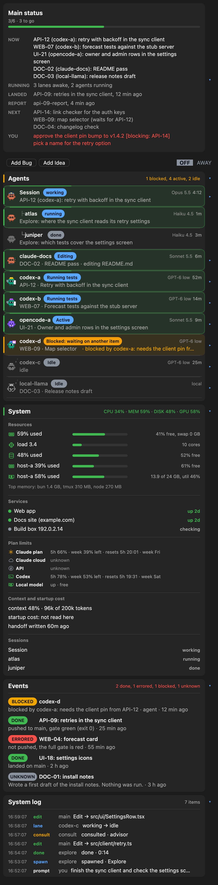
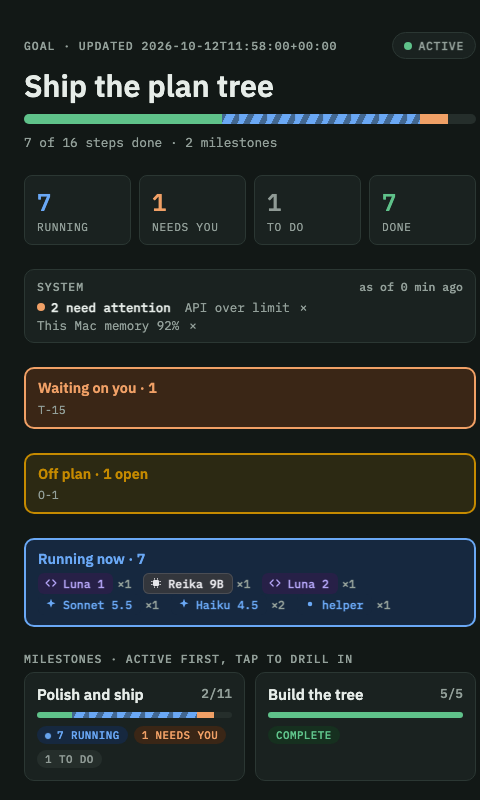
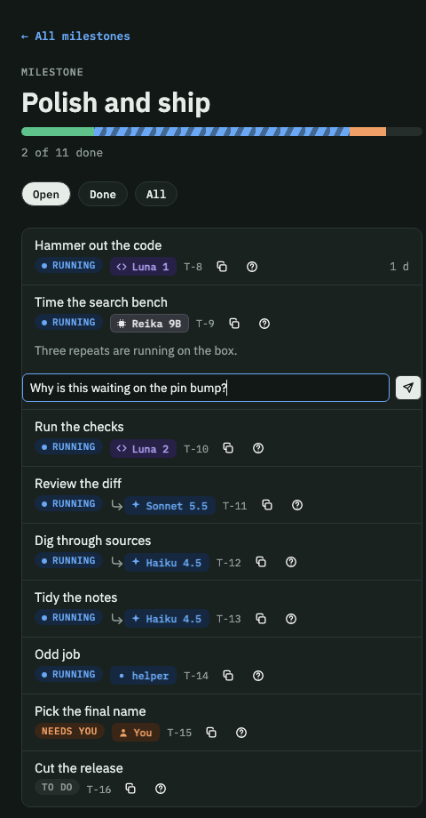

# Claude Cockpit

A live status row, side pane and agent view for Claude Code. It shows what your sessions and agents are doing, and how much plan and credit you have left.

<p align="center"><b>The band above the prompt: progress, pills and credits</b></p>

<p align="center">
  <picture>
    <source media="(prefers-color-scheme: light)" srcset="docs/img/status-row-light.png">
    
  </picture>
</p>

<p align="center"><b>The plan, live</b></p>

<p align="center">
  <picture>
    <source media="(prefers-color-scheme: light)" srcset="docs/img/plan-running-light.gif">
    
  </picture>
</p>

<p align="center"><b>The full side pane: every section open</b></p>

<p align="center">
  <picture>
    <source media="(prefers-color-scheme: light)" srcset="docs/img/pane-all-light.png">
    
  </picture>
</p>

## Why you want it

- **See every agent at a glance.** One pane shows who is editing, who is running tests, who is blocked and who is waiting on you. No more hopping between terminals.
- **Know how far along you are.** A progress bar and a done count (like 7/10) sit right above your input box. The plan is a calm tree (plan, milestones, steps) that stays collapsed until you open a part, with a tiny animated worker under each running step. Try it without a session: `bun tools/plan-preview.ts`.
- **Never get surprised by your limits.** Meters show what is left on your Claude plan, Claude cloud, API spend and Codex.
- **Leave it running.** Flip AWAY before you go. Your main session keeps working without stopping to ask, and writes down its choices for you to read when you are back.
- **Keep it private.** Nothing leaves your machine. Cockpit reads local session files and runs local commands, and that is all.

## The plan page

<p align="center">
  <picture>
    <source media="(prefers-color-scheme: light)" srcset="docs/img/page-home-light.png">
    
  </picture>
  <picture>
    <source media="(prefers-color-scheme: light)" srcset="docs/img/page-steps-light.png">
    
  </picture>
</p>

Run `plan-page-build` and publish the result as an Artifact, and the pane shows the plan as a page. Each milestone and step opens in place. On every step:

- **Ask a question.** Type a question or instruction and press send. With the Artifact runtime it goes to your session as a message (`API-12: why is this blocked?`). Without it, the text is copied for you to paste.
- **Copy ID.** One click copies the step id, so you can name it in any prompt.
- **Expand items.** Open a milestone to see its steps, and a step to see its owner, start time and notes.
- **Dismiss system issues.** Usage at 70% or more, cloud credits near expiry, a host that is offline or a service that is down show as attention items. Dismiss one and it stays hidden on that browser until the issue clears and comes back.

The in-terminal pane has the same actions on each row: a check (mark done), an X (remove, with an 8 second undo), a question mark (asks the session to explain, or to ask you), retry, and keys 1 to 9 to open an agent card.

## Rules for Claude

Cockpit shows what your sessions write down, so each project needs a short block in its `CLAUDE.md`. Copy it from [docs/RULES-FOR-CLAUDE.md](docs/RULES-FOR-CLAUDE.md). It is about 170 tokens a session. The band, pane and pills are drawn locally and cost the model nothing; the page lists exactly what does cost tokens.

## Install

You need Claude Code. Add tmux if you want to watch Codex or local-model sessions too.

1. Add the marketplace:

   ```
   claude plugin marketplace add JesseWebDotCom/claude-cockpit
   ```

2. Install the plugin:

   ```
   claude plugin install cockpit@claude-cockpit
   ```

   It may print "7 userConfig options not yet set". That is fine: every option is optional and has a default, so you can ignore it.

3. Restart Claude Code and type `/cockpit`. The pane opens. Type it again to close it.

Want to try it first? Clone the repo and run `claude --plugin-dir ./claude-cockpit`. Nothing gets installed.

On a fresh project the pane is mostly empty. It tells you which small files to create. To see a full pane right away, look at `examples/project`.

## Make it yours

Cockpit works with no setup. When you want to change something, add `.cockpit/config.json` to your project. Every key is optional.

```json
{
  "owner": "alex",
  "lanes": [{ "name": "claude-docs", "kind": "tmux" }],
  "services": [{ "name": "Web app", "kind": "http", "target": "http://localhost:3000/health" }]
}
```

Run `/cockpit-status` to see which config files were read and if anything is wrong. Every setting is in [docs/CONFIG.md](docs/CONFIG.md).

## Learn more

- [Every feature and every part of the pane](docs/FEATURES.md)
- [Rules for Claude, and what they cost in tokens](docs/RULES-FOR-CLAUDE.md)
- [The plain files your agents write](docs/PROTOCOL.md)
- [Changelog](docs/CHANGELOG.md)

## Credits and license

Cockpit is MIT licensed, see [LICENSE](LICENSE). It builds on two MIT projects, [claude-flightdeck](https://github.com/scasella/claude-flightdeck) and [savvy-progress](https://github.com/JohnnyVizz/claude-kit/tree/main/plugins/savvy-progress). Their notices are in [NOTICE](NOTICE).
