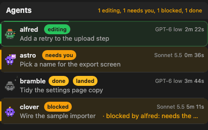
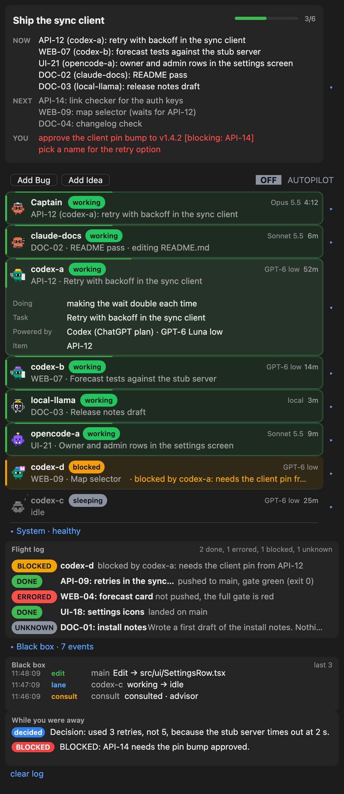
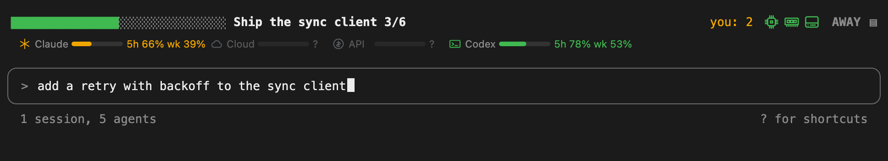
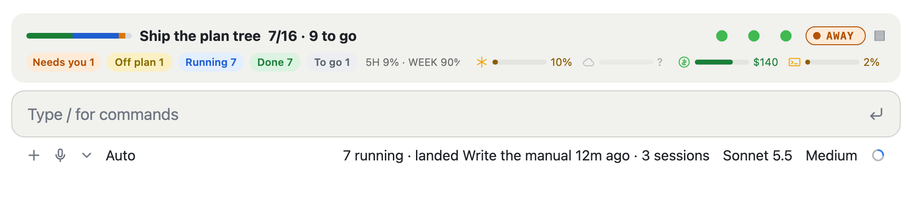

# Features and the pane, in full

The short version is in the [README](../README.md).

## What the pane shows

The pane is one scrolling page. Top to bottom:

1. **Status card.** The milestone, a progress bar and count, then NOW, NEXT and YOU in one line each. The arrow opens all three in full.
   YOU is what waits on you; it turns red when something is blocked on it.
2. **Buttons.** Add Bug and Add Idea (one line of text, saved to a file and sent to your coordinating session), and an AWAY switch: the word AWAY in grey when off and green when on (colour is the only state; there is no "off" or "on" text).
3. **Agents.** A collapsible line ("Agents", with a summary such as "2 editing, 1 running tests, 1 idle"; open by default, and the choice is remembered) over one row per agent session, with an animated character, a status word, the item it owns, what powers it (GPT-6, Sonnet 5.5,
   local) and how long it has been in that state. The main session (the one Cockpit runs in) is first. An active row has a moving green
   border, a blocked or waiting row is amber, a failed one is red, a sleeping one is grey. Open a row for what it is doing, its task,
   its last report and its limits. An agent whose account refused it shows a red label on its row (OUT OF CREDIT, RATE LIMITED or AUTH FAILED) with the matching output line on its card, a red count in the Agents summary, and a red chip on the status card and the status bar; it clears when newer output no longer shows the error.

   
4. **System card.** Collapsed to one line ("System: healthy"). Open it for this computer's memory, CPU and disk gauges (each row starts with
   its icon in the gauge's health colour), the plan limits,
   and, if you list them under `hosts` and `services` in the config, other computers (memory, GPU) and services (up or down).
   Nothing listed means nothing else is checked. The five sections always appear in one fixed order (Main status, Agents, System, Events, System log) and every header is always visible. Each section has its own open or closed flag, saved on its own and written only by that section's arrow; opening or closing one never moves, opens, closes or hides another. Main status and Agents start open, the other three closed. When the open bodies are taller than the pane, the whole pane scrolls as one column.
5. **Events.** What finished and what did not, newest first: DONE, ERRORED, BLOCKED or UNKNOWN, two rows each (the status and the title, then the details: what happened, who did it and when, cut to one line), judged from the
   agents' report files.
6. **System log.** The last items of this session: your prompts, subagents, edits, errors, denied tool calls, and lanes changing between
   busy and idle. Open it for the last 40.

When you press AWAY, Cockpit tells the main session you are away and to log its decisions. A "While you were away" card then collects
them for when you return.



## Features

- **tmux lanes.** Any tmux session named `codex-*`, `opencode-*`, `local-*` or `cloud-*` is an agent row. Name others under `lanes` in the config.
  What it is doing comes from what the last lines of the pane show, and you can set your own markers.
- **Codex.** Reads the model line of the Codex screen, and shows the 5 hour and weekly usage in an open row, from Codex's own session
  logs.
- **OpenCode.** Reads the model of a running `opencode run` and ties the run to the lane whose pane shows its brief.
- **Local models.** A `local-*` session is a row. Give it markers for your server ("Generating", "tokens/s").
- **Claude Code sessions in tmux.** Listed under `lanes` with kind `tmux`; "esc to interrupt" means busy.
- **Plain-word rows.** A row shows an item id and a short title written by a person (the claim file's third line), never a scraped
  fragment of code or log text. Text that does not read as plain words is dropped.
- **Declared state words, and no others.** Editing, Running tests, Reading, Searching, Browsing, Reviewing, Planning, Active (when the activity cannot be told), Needs you, Blocked (with its reason), Done (with how long ago) and Idle. One list in `hooks/activity.ts` feeds every row, chip and count. The count line reads "1 session, 5 agents (2 editing, 1 running tests, 1 needs you)": a session is a conversation (this one plus each awake tmux lane), an agent is a subagent a session started, and zero counts are left out.
- **Gate and gate-lock aware.** A lane that waits for a shared gate lock is blocked on it. A failing test or gate shows "Blocked: gate failed".
- **The Deck.** A second pane (`/cockpit deck`) for this session's own events: context, permission checks, subagents, a turn receipt and a
  log.
- **Other computers and services.** List `hosts` (read through ssh) and `services` (a GET each) in the config and the System card shows
  them under the names you gave. None by default.
- **The status row above the input box.** Row 1 of the bar reads, left to right: a progress bar, the milestone title once, and the done count
  right after it ("9/10"). The bar, the title and the count are plain coloured text (block cells, green for done and dim for left), not a
  picture, so the host always draws them. The bar is 12 to 30 cells and shrinks to 12 before the title truncates with an ellipsis; the
  count is never dropped. At the right edge: "you: N" when something waits on you, a "!" badge when an agent errored, four small system
  icons, the AWAY switch and the pane button. Nothing in the bar is an expand control.
- **The line under the input box.** It shows the session and agent count and nothing else, for example "1 session, 5 agents" (the
  breakdown in brackets is dropped when the line would run past 56 characters). If you list repositories under `repos` in the config, the
  same line also gets "all saved" or "unsaved: 3 uncommitted files, 1 unpushed commit" every 30 seconds, and whichever was written last is
  the one you see. That line holds text only: no colour, no icons.
- **System icons.** A chip (CPU), a memory stick, a drive (disk) and a graphics card (GPU, only when a listed host reports one), each
  coloured by the same level the System card draws, with the figure as its tooltip. They sit at the right end of row 1, left of AWAY.
- **Credit row.** Row 2 of the bar is one packed line, flush left, in a fixed order: Claude plan, Claude cloud, API, Codex. Each
  service is a small icon, a bar of what is left (block characters, because the host's bar row draws text) and a short figure. Green is fine,
  amber is low, red is out; a grey icon with an empty bar and `?` means Cockpit cannot read it, and no balance is invented. The local model is
  not on this line (it stays in the Main status card and the System card). A narrow row shortens the bars first, then the figure, and never drops a
  service. The icons are simple generic marks drawn by Cockpit (an asterisk, a cloud, a coin, a terminal prompt), distinct in shape so colour is
  never the only cue; the same marks lead the rows of the Main status card. No vendor logo is used.





The pictures are drawn from the plugin's own row functions in a headless browser. A browser draws the block cells with hairline seams that a terminal does not.

- **Light and dark themes**, and motion that stops when you turn it off.

## Commands

| Command | What it does |
|---|---|
| `/cockpit` | Show or hide the pane |
| `/cockpit away on` or `off` | Switch AWAY (a bare `away` toggles; `autopilot` still works as an old alias) |
| `/cockpit bug <text>`, `/cockpit idea <text>` | Save a line to `inbox/bugs.md` or `inbox/ideas.md` |
| `/cockpit start`, `restart`, `clear <lane>` | Start, restart or clear a lane; each asks for a y first |
| `/cockpit layout`, `deck`, `motion`, `panels` | Options for the Deck and the pane |
| `/cockpit-status` | Poll once and print the pane as text (works where no pane can draw) |
| `/handoff` | Write `.cockpit/handoffs/HANDOFF-<date>.md` from the status, the locks and what landed |

`/agents` and `/lanes` are aliases of `/cockpit`.

## The files Cockpit reads

Cockpit reads files under your project's `.cockpit` folder. The three that matter most:

- `status.json`, written by your coordinating agent: milestone, done and total, next, you. Everything else on the Main status card fills itself:
  NOW is the active claims, RUNNING counts awake lanes and running agents, LANDED is the newest commit in your `repos`, REPORT is the newest report.
  When the file is older than `notesHours` (default 6) the Next and You lines get a small dim "notes from 2d ago"; the card never says stale.
  `tools/status-set <key> <value...>` patches one key (milestone, done, total, next, you) and stamps `updated`.
  Under the lines the card always shows five service rows (Claude plan, Claude cloud, API, Codex, local model): a bar of what is left, the reset or expiry, and a small
  "auto" or "manual" marker with the age of the reading. Claude plan, Codex, API and the local model are read automatically (the usage cache, Codex's session files,
  the spend database since the baseline date in `credits.json`, a health probe); Claude cloud is manual (days to its expiry date). A manual figure older than 24 hours
  shows "check"; an unknown figure shows "unknown", never a blank.
- `claims/<ITEM>.claim`, written by a worker that takes an item: line 1 the item id, line 2 `lane: <session>`, line 3 a plain title,
  and an optional `now: <sentence>`.
- `reports/<item>-report.md`, written by a worker that stops: a heading and a `Status:` line.

[PROTOCOL.md](PROTOCOL.md) has every file, every rule for how a row or a report is judged, and the closed list of status words.

## Develop

```
bun test                      # about 720 tests in 34 files, no Claude Code needed
bun tools/demo.ts             # rewrite examples/project
bun tools/shot.ts             # redraw docs/img from examples/project (needs Chrome; set CHROME if it is not the macOS default)
```

Type-check with `tsc --noEmit -p tsconfig.json`. It needs the host's type files in `.claude-plugin/types`, a generated cache that git
ignores, so a fresh clone does not have them and the type-check cannot run there. `hooks/` holds the code: nearly all of it is
pure functions with no host calls, and only `hooks/register.tsx` talks to Claude Code.
